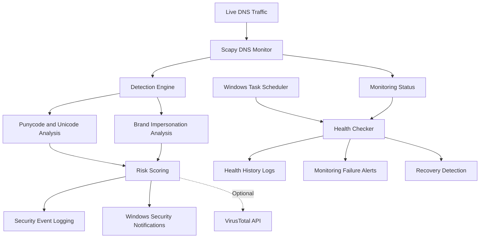
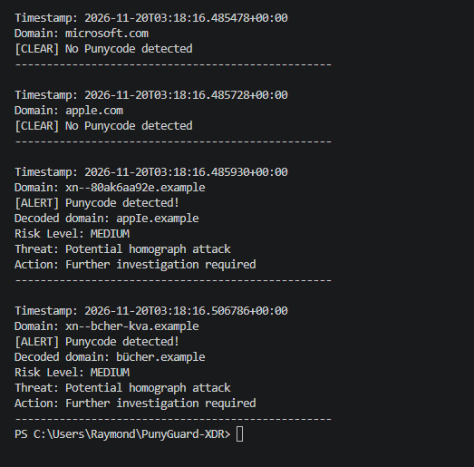

# 🛡️ PunyGuard XDR v1.0

### Automated DNS Threat Detection, Security Monitoring & Health Monitoring


## Project Overview

PunyGuard XDR is a Python-based cybersecurity detection prototype designed to identify potential phishing threats, Punycode homograph attacks, Unicode domain impersonation, and suspicious DNS activity.

The project combines real-time network monitoring, automated threat analysis, risk scoring, structured security logging, Windows desktop notifications, and monitoring health checks.

Built as a hands-on SOC Analyst portfolio project, PunyGuard XDR demonstrates practical security monitoring, detection engineering, incident investigation, and defensive automation.

---

## Key Features

- Real-time DNS traffic monitoring using Scapy
- Punycode and Unicode homograph detection
- Automated brand impersonation analysis
- Threat risk scoring from 0 to 100
- Windows desktop security notifications
- Structured JSON security event logging
- VirusTotal threat intelligence integration
- DNS duplicate filtering
- Automated five-minute health checks
- Monitoring failure detection
- Recovery detection and logging
- Persistent monitoring history
- Windows Task Scheduler automation
- Environment-based API credential management

---

## System Architecture



---

## Technology Stack

| Technology | Purpose |
|---|---|
| Python | Security automation |
| Scapy | DNS packet capture |
| psutil | Process health monitoring |
| winotify | Windows desktop notifications |
| VirusTotal API | Optional threat intelligence |
| Requests | API communication |
| python-dotenv | Credential management |
| JSON / JSONL | Structured security logging |
| Windows Task Scheduler | Automated execution |
| Git and GitHub | Version control and documentation |

---

## Threat Risk Classification

| Risk Score | Classification |
|---|---|
| 0–29 | Low |
| 30–49 | Medium |
| 50–69 | High |
| 70–100 | Critical |

Risk scores are heuristic indicators used to prioritize suspicious domains for further investigation. They do not independently establish malicious activity.

---

## Automated Monitoring

PunyGuard XDR uses Windows Task Scheduler to automate DNS monitoring and recurring health checks.

The health checker runs every five minutes and records:

- Monitoring process availability
- DNS packets captured
- Most recent DNS activity
- Monitoring failures
- Recovery events
- Health-check timestamps

Quiet DNS periods are evaluated separately from monitoring process failures to reduce unnecessary warnings.

---

## Testing and Validation

| Test | Result |
|---|---|
| Punycode detection | Passed |
| Brand impersonation detection | Passed |
| Risk scoring | Passed |
| Live DNS packet capture | Passed |
| Windows desktop notifications | Passed |
| Structured security logging | Passed |
| Scheduled five-minute health checks | Passed |
| Monitoring failure detection | Passed |
| Failure history logging | Passed |
| Recovery detection | Passed |
| Recovery history logging | Passed |
| Simulated alert deduplication | Passed |
| Live alert deduplication | Further validation required |
| Live VirusTotal enrichment | Further validation required |

### Live Monitoring Results

During controlled testing, PunyGuard XDR recorded:

- More than 28,000 captured DNS packets
- Successful recurring five-minute health checks
- Automatic detection of an intentionally stopped DNS monitor
- Repeated failure logging during the outage
- Successful recovery detection following a manual restart
- Resumed DNS packet capture

These results demonstrate functional monitoring and recovery detection in a controlled Windows environment.

---

## SOC Analyst Skills Demonstrated

- Network traffic analysis
- DNS security monitoring
- Phishing threat detection
- Detection engineering
- Threat intelligence integration
- Security alert triage
- Python security automation
- Incident detection and investigation
- Monitoring availability assessment
- Failure and recovery validation
- Structured security event analysis
- Secure credential management

---

## MITRE ATT&CK Relevance

| Technique | Description |
|---|---|
| T1566 | Phishing |
| T1566.002 | Spearphishing Link |
| T1583.001 | Acquire Infrastructure: Domains |
| T1036 | Masquerading |

These techniques provide investigative context for suspicious domain activity. A PunyGuard alert alone does not confirm that an ATT&CK technique has occurred.

---

## Project Structure

```text
PunyGuard-XDR/
├── screenshots/
├── brands.json
├── brand_detector.py
├── desktop_alert.py
├── detector.py
├── dns_monitor.py
├── health_check.py
├── security_logger.py
├── test_dns_pipeline.py
├── threat_intel.py
├── requirements.txt
├── .gitignore
└── README.md
```

Runtime logs, virtual environments, Python cache files, and private API credentials are excluded from version control.

---

## Installation

### Prerequisites

- Windows
- Python 3
- Git
- Npcap
- Appropriate packet capture permissions

### Clone the Repository

```powershell
git clone https://github.com/rcredd85/PunyGuard-XDR.git
cd PunyGuard-XDR
```

### Create a Virtual Environment

```powershell
python -m venv .venv
```

### Install Dependencies

```powershell
.\.venv\Scripts\python.exe -m pip install -r requirements.txt
```

### Optional Threat Intelligence Configuration

Create a local `.env` file containing:

```text
VIRUSTOTAL_API_KEY=your_api_key_here
```

Never publish your actual API credentials.

### Run DNS Monitoring

```powershell
.\.venv\Scripts\python.exe dns_monitor.py
```

Review the network interface configuration before starting packet capture.

### Run a Health Check

```powershell
.\.venv\Scripts\python.exe health_check.py
```

### Review Monitoring History

```powershell
Get-Content .\logs\health_history.jsonl -Tail 5
```

---

## Detection Evidence

### Punycode Detection



### Brand Impersonation Detection


### Automated Critical Threat Alerts


### VirusTotal Threat Intelligence


---

## Known Limitations

- Live VirusTotal lookups were disabled during controlled DNS monitoring tests.
- Live notification deduplication requires additional validation.
- Encrypted DNS traffic may not be visible to conventional DNS packet capture.
- Risk scoring is heuristic and may produce false positives.
- Monitoring process availability does not independently guarantee successful packet capture.
- Monitoring recovery was tested using a manual restart.
- Windows Task Scheduler must be configured separately for automated execution.

---

## Future Enhancements

- AI-assisted alert analysis and summarization
- Microsoft Sentinel integration
- Wazuh SIEM integration
- Automated incident response workflows
- Centralized security dashboard
- Enhanced domain reputation analysis
- Independent monitoring heartbeat
- Automated monitoring recovery

---

## Disclaimer

PunyGuard XDR is an educational cybersecurity detection prototype intended for defensive security research, authorized network monitoring, and professional skills development.

It is not a replacement for an enterprise-grade XDR, EDR, or SIEM platform.

---

## Author

**Raymond Cotton**

Cybersecurity | SOC Analysis | Threat Hunting | Security Automation

[GitHub Portfolio](https://github.com/rcredd85)

[LinkedIn Profile](https://www.linkedin.com/in/raymond-cotton-2a377742/)

---

**Detect. Analyze. Monitor. Defend.**
