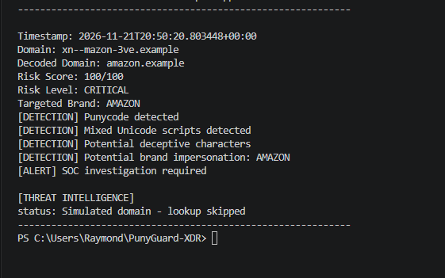
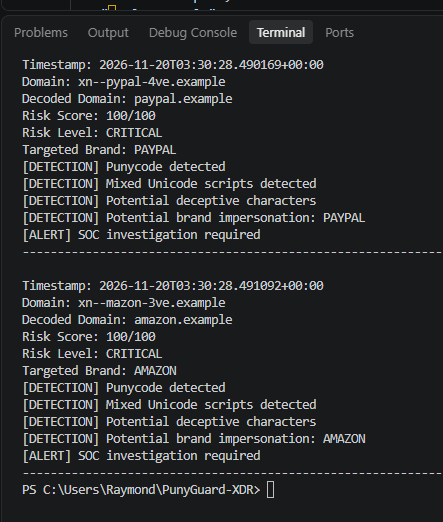
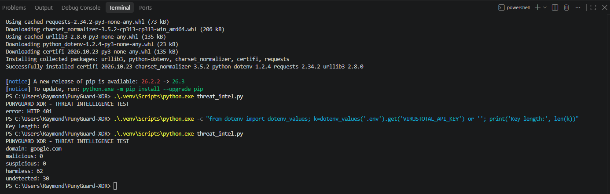

# 🛡️ PunyGuard XDR

### Real-Time DNS Monitoring & Phishing Detection

PunyGuard XDR is a Python-based cybersecurity
detection prototype designed to identify Punycode
homograph attacks and potential brand impersonation.

## Key Features

- Live DNS traffic monitoring using Scapy
- Punycode and Unicode homograph detection
- Automated brand impersonation analysis
- Threat risk scoring from 0 to 100
- Windows desktop security notifications
- Structured JSON security event logging
- VirusTotal threat intelligence integration
- DNS duplicate filtering

## SOC Analyst Skills Demonstrated

- Network traffic analysis
- Phishing detection and investigation
- Threat intelligence enrichment
- Python security automation
- Security monitoring and alert triage

## Project Status

Functional cybersecurity detection prototype.
Live DNS monitoring and Windows notifications
have been tested successfully.

Live threat intelligence lookups are disabled
during controlled DNS monitoring tests.

---

## Detection Evidence

### Punycode Detection

### Brand Impersonation Detection

### Automated Critical Threat Alerts

### VirusTotal Threat Intelligence

